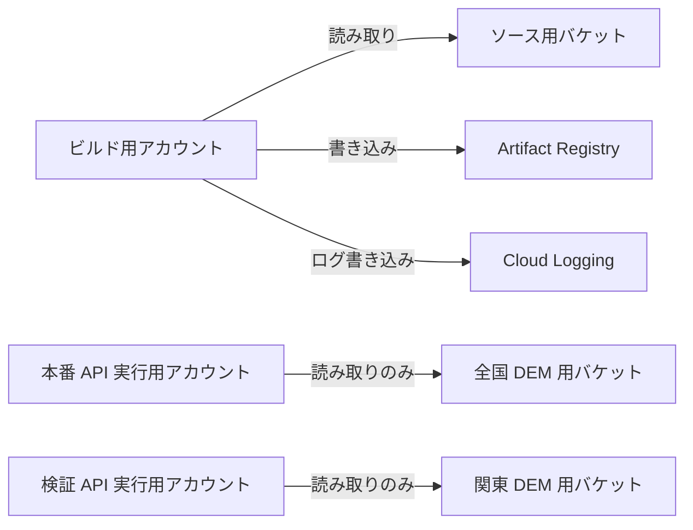

# 本番 API の配置記録

以下は Issue #39 の作業時点の記録である。
その後の画面配置と動作確認は [Hosting の配置記録](hosting-deployment.md) を参照する。

Issue #39 の全国 DEM と Python API の配置を、2026-10-17 に実施した。
本書は、開発者が共有したコマンドの実行結果と、コンソールで確認した内容の報告に基づく。
本プロジェクトは学習を目的とし、設定の役割と再開時の確認手順も残す。
機能範囲は [MVP 仕様](mvp-spec.md) を正本とする。
API の契約と汎用的な配置手順は [API の README](../api/README.md) を参照する。

## ローカルの設定値

実際のプロジェクト ID、バケット名、サービスアカウント、URL、ビルドとリビジョンの識別子は、プロジェクトルートの `.env` に記録する。
公開文書の `${変数名}` は、そのファイルの値を参照する。
`.env` は `.gitignore` で除外し、認証情報は保存しない。
API キー、秘密鍵、トークンは従来どおり別に管理する。

コマンドはリポジトリルートから、管理者自身が内容を確認した `.env` を読み込んで実行する。
`source` はファイルをシェルのコードとして実行するため、第三者から受け取ったファイルをそのまま読み込まない。

```bash
set -a
source ./.env
set +a
```

`.env` はビルドソースと Docker の許可リストにも含まれない。
新しいチェックアウトには存在しないため、運用記録の保管先から用意する。
Git の除外はアクセス権限の代わりにはならず、過去のコミットに含まれた実値も削除しない。

## 現在の状態

全国 DEM のアップロードと照合、API イメージのビルド、Cloud Run への配置を終えた。
公開 API で東京駅と札幌駅の予報、入力不正、観測地点の標高欠損を確認した。
動作確認後は学習作業を中断するため、CLI で公開アクセスを解除した。
開発者は変更から約 1 分後に、認証なしの `curl` が HTTP 403 を返すことを確認した。
画面の公開接続は #40、クラウド MVP 全体の受入確認と運用手順は #41 で扱う。
Issue #39 のクローズ操作はこの記録の作成には含めない。

## リソースの役割

| リソース | 用途 | 今回の記録値 |
| --- | --- | --- |
| 本番プロジェクト | API と保存先の管理単位 | `${PROJECT_ID}` |
| リージョン | 本番 API と関連リソースの配置先 | `asia-northeast1`（東京） |
| Cloud Storage | ビルドへ渡すソースの保存先 | `${BUILD_SOURCE_BUCKET}` の `source/` |
| Cloud Storage | 全国 DEM の保存先 | `${DEM_BUCKET}` の `derived-dem10b-v1/` |
| Artifact Registry | API のコンテナイメージ保存先 | Docker リポジトリ `yoiyuuyake` |
| Cloud Run | 本番 API を実行するサービス | `yoiyuuyake-api` |
| Cloud Storage / Cloud Run | 関東 DEM による検証用リソース | `dem-benchmark` 系。詳細は [検証記録](cloud-benchmark.md) |

API の URL は `.env` の `SERVICE_URL` に記録する。
ルートパスではなく `/api/forecast?lat=…&lng=…` を呼び出す。
初回の動作確認では API をログイン不要で公開し、DEM バケットは非公開で運用する構成とした。
現在は API の認証なしアクセスを遮断している。
本番サービスはログイン不要での利用を目指し、一般公開前に連続アクセス制限と費用管理を整える。

## 権限の分担

**サービスアカウント**はクラウド上で処理するプログラムの身分である。
**IAM** は誰に、どのリソースに対して、どの操作を許可するかを管理する。
プロジェクト単位のロールがなくても、バケット単位でロールを付与すれば、そのバケットへアクセスできる。

| 身分 | 権限の対象 | 確認したロール |
| --- | --- | --- |
| ビルド用 `yoiyuuyake-build` | ソース用バケット | `roles/storage.objectViewer` |
| 同上 | Artifact Registry の `yoiyuuyake` | `roles/artifactregistry.writer` |
| 同上 | プロジェクト | ログ書き込みロール |
| 本番 API 実行用アカウント | `${DEM_BUCKET}` | `roles/storage.objectViewer` |
| 検証 API 実行用アカウント | `dem-benchmark` バケット | `roles/storage.objectViewer`。プロジェクト IAM にロールの表示なし |

ビルド用アカウントのメールアドレスは `${BUILD_SERVICE_ACCOUNT}`。
本番 API の配置コマンドでは `${RUNTIME_SERVICE_ACCOUNT}` を指定した。
サービスに現在割り当てられているアカウントは、後述の手順で設定を取得して再確認する。

検証サービスに割り当てられた既存アカウントは、当初の表示名が `Yoiyuyake API Runtime` だった。
検証用と本番用を区別するため、既存アカウントの表示名を `Yoiyuuyake DEM Benchmark Runtime`、本番用を `Yoiyuuyake Production API Runtime` とする方針で案内した。
表示名の変更が完了したことと、検証用アカウントの正式なメールアドレスは、共有された出力では確認していない。
再開時は表示名だけで用途を判断せず、Cloud Run の割り当て先メールアドレスとバケットの権限を確認する。



DEM の生成とアップロードは、開発者が手元の PC で実施した。
ビルド用アカウントは API のイメージを作成し、DEM は生成しない。
本番 API は実行時に必要な DEM を読み取る。

## 全国 DEM の配置

### バケット設定

開発者が `${DEM_BUCKET}` の次の設定をコンソールで確認した。

| 項目 | 設定 |
| --- | --- |
| ロケーション | `asia-northeast1` |
| ストレージクラス | Standard |
| 公開アクセスの防止 | 有効 |
| アクセス制御 | 均一 |
| 階層型名前空間 | 無効 |

### ローカル検証

リポジトリルートで実行した。

```bash
python3 terrain/scripts/validate_dataset.py \
  --data gsi/derived-dem10b-v1 \
  --expected-tiles 4885
```

| 項目 | 結果 |
| --- | ---: |
| format_version | 1 |
| tile_count | 4,885 |
| total_cells | 4,121,718,750 |
| total_tile_bytes | 8,243,437,500（約 7.68 GiB） |
| missing_cells | 989,078,825 |
| missing_ratio | 0.23996756814132453 |
| 南端 / 北端 | 20.416666667 / 45.583333333 |
| 西端 / 東端 | 122.875 / 154.0 |

欠損率は格納セル全体に対する割合であり、日本の陸地の欠損率を意味しない。
必要なセルが欠損していれば、現在の仕様では評価を失敗させる。
元データと生成方法は [全国 DEM の準備](dem10b-setup.md) を参照する。

### 転送と照合

まず `--dry-run` で転送先を確認し、同じコマンドから `--dry-run` を外してアップロードした。

```bash
gcloud storage rsync \
  gsi/derived-dem10b-v1 \
  gs://${DEM_BUCKET}/derived-dem10b-v1 \
  --recursive \
  --dry-run

gcloud storage rsync \
  gsi/derived-dem10b-v1 \
  gs://${DEM_BUCKET}/derived-dem10b-v1 \
  --recursive
```

転送後はファイル内容のチェックサムで照合した。

```bash
gcloud storage rsync \
  gsi/derived-dem10b-v1 \
  gs://${DEM_BUCKET}/derived-dem10b-v1 \
  --recursive \
  --checksums-only \
  --dry-run
```

ローカルとクラウドの双方で 4,886 ファイルを列挙し、結果は `Completed files 0 | 0B` だった。
4,885 タイルと `index.json` が揃い、コピー対象となる差分がなかった。
この照合は任意地点での評価の成功や、元の標高データの正確さまで保証するものではない。

## API のビルド

リポジトリルートで次のコマンドを実行した。
`api/source.gcloudignore` で送信対象を制限し、DEM や認証情報をソースに含めない。

```bash
gcloud builds submit . \
  --project=${PROJECT_ID} \
  --region=asia-northeast1 \
  --config=api/cloudbuild.yaml \
  --ignore-file=api/source.gcloudignore \
  --gcs-source-staging-dir=gs://${BUILD_SOURCE_BUCKET}/source \
  --service-account=projects/${PROJECT_ID}/serviceAccounts/${BUILD_SERVICE_ACCOUNT} \
  --machine-type=e2-standard-2 \
  --timeout=10m
```

| 項目 | 結果 |
| --- | --- |
| ビルド ID | `${BUILD_ID}` |
| 作成時刻 | 2026-10-17 22:12:00 JST |
| 所要時間 / 結果 | 31 秒 / `SUCCESS` |
| イメージ | `${IMAGE_URL}` |

ビルド定義はコンテナの作成と Gunicorn の設定検査を行い、イメージを保存する。
この成功だけでは、Cloud Run での DEM 読み取りや気象取得の成功は確認できない。
ビルド対象の Git コミット、未コミット変更の有無、イメージのダイジェストは今回の共有出力には含まれていない。

## Cloud Run の配置

次のコマンドを案内し、開発者から配置後のサービス URL と API 応答を受領した。
以下は配置時に指定した設定であり、現在のサービス設定を取得して照合した結果ではない。

```bash
gcloud run deploy yoiyuuyake-api \
  --project=${PROJECT_ID} \
  --region=asia-northeast1 \
  --image=${IMAGE_URL} \
  --service-account=${RUNTIME_SERVICE_ACCOUNT} \
  --execution-environment=gen2 \
  --cpu=1 \
  --memory=512Mi \
  --concurrency=1 \
  --min=0 \
  --max=1 \
  --cpu-throttling \
  --no-cpu-boost \
  --timeout=60s \
  --allow-unauthenticated \
  --invoker-iam-check \
  --set-env-vars=DEM_ROOT=/dem/derived-dem10b-v1 \
  --add-volume=name=dem-cache,type=in-memory,size-limit=160Mi \
  --add-volume-mount=volume=dem-cache,mount-path=/dem-cache \
  --add-volume="name=dem,type=cloud-storage,bucket=${DEM_BUCKET},readonly=true,mount-options=cache-dir=cr-volume:dem-cache;file-cache-max-size-mb=128;file-cache-cache-file-for-range-read=true" \
  --add-volume-mount=volume=dem,mount-path=/dem
```

`${DEM_BUCKET}` の中身を `/dem` に読み取り専用でマウントする。
API は `DEM_ROOT` で指定した `/dem/derived-dem10b-v1` を参照する。
FUSE のファイルキャッシュは読み取ったタイルを一時保持し、全国 DEM 全体をメモリへコピーしない。
キャッシュ上限 128 MiB、キャッシュ用メモリボリューム上限 160 MiB とし、コンテナのメモリは 512 MiB とした。

`--min=0` と `--max=1` は起動数の設定であり、費用の上限保証ではない。
根拠となる地形読み取りの検証は [構成選定の記録](cloud-benchmark.md) を参照する。
今回共有されたアクセスログのリビジョン名は `${API_REVISION}` だった。
リビジョン番号が増えた経緯は記録していない。

### 設定の再確認

再開時には対象プロジェクトと現在の設定を読み取り専用で取得する。
サービスアカウント、イメージ、環境変数、マウント、CPU、メモリ、スケーリング、トラフィックの向き先を上記と照合する。

```bash
gcloud run services describe yoiyuuyake-api \
  --project=${PROJECT_ID} \
  --region=asia-northeast1 \
  --format=yaml

gcloud run services get-iam-policy yoiyuuyake-api \
  --project=${PROJECT_ID} \
  --region=asia-northeast1

gcloud storage buckets describe gs://${DEM_BUCKET} --format=yaml

gcloud storage buckets get-iam-policy gs://${DEM_BUCKET}
```

バケットの公開アクセス防止と、本番実行用アカウントの閲覧者ロールを確認する。
Cloud Run への未認証アクセス許可と、DEM の非公開設定を分けて確認する。
文書作成時点ではこれらのコマンドによる設定の取得と、配置後もバケットが非公開であることの再確認は実施していない。

### 更新

ソースを更新した場合はビルドを再実行し、新しいビルド ID のイメージ URL を控える。
Cloud Run の配置コマンドの `--image` をその URL へ差し替え、他の設定が意図どおりであることを確認して実行する。
更新後は設定取得と次節の API 確認を行う。
ビルドのたびに全国 DEM をアップロードする必要はない。
DEM を更新する場合は、稼働中のデータを途中まで置き換えず、新しい保存先で照合してから参照先を変更する。
前述の配置コマンドは `--allow-unauthenticated` を指定しているため、再実行すると API が公開される。
作業中断時の公開アクセス解除は次節を参照する。
切り戻し、サービスの停止、削除の実施手順と検証は #41 で整備する。

## 学習中の公開アクセス管理

作業をしない間は、Cloud Run の IAM 認証チェックを有効にし、`allUsers` の呼び出し許可を外す。
これはサービスの削除や停止ではなく、認証なしの呼び出しを遮断する操作である。
呼び出し権限を持つ認証済み利用者は引き続きアクセスできる。
DEM、イメージ、ビルドソースなどは残るため、保存費用は継続する。
最小インスタンス数 0 だけでは、アクセスに応じて起動するため、公開アクセスを止められない。

> [!WARNING]
> 2026-10-17 の操作では、Cloud Run コンソールの「allUsers のアクセス権を削除」を押して POST の HTTP 200 を受け取っても、CLI で取得した IAM ポリシーには `allUsers` の許可が残った。
> CLI で変更した後は約 1 分で認証なしの `curl` が HTTP 403 となった。
> コンソール側の問題が疑われるが、原因は特定していない。
> ボタン操作や HTTP 200 だけで解除完了と判断せず、IAM ポリシーと認証なしのアクセス結果を確認する。

### 作業終了時

`allUsers` に直接付与した呼び出し権限を削除する。
この IAM ポリシー変更にコンテナの再ビルドや再デプロイは不要である。

```bash
gcloud run services remove-iam-policy-binding yoiyuuyake-api \
  --project=${PROJECT_ID} \
  --region=asia-northeast1 \
  --member=allUsers \
  --role=roles/run.invoker
```

続いて IAM 認証チェックを明示的に有効にする。
こちらは Cloud Run のサービス設定を更新する操作である。

```bash
gcloud run services update yoiyuuyake-api \
  --project=${PROJECT_ID} \
  --region=asia-northeast1 \
  --invoker-iam-check
```

次のコマンドで `allUsers` と `roles/run.invoker` の組み合わせが残っていないことを確認する。

```bash
gcloud run services get-iam-policy yoiyuuyake-api \
  --project=${PROJECT_ID} \
  --region=asia-northeast1
```

さらに、認証情報を付けずに呼び出し、HTTP 403 になることを確認する。
API の JSON と HTTP 502 が返る場合は、API の処理まで届いており、遮断を確認できていない。
IAM の変更には反映まで時間がかかる場合がある。

```bash
curl --silent --show-error \
  --max-time 65 \
  --write-out '\nHTTP %{http_code}\n' \
  "${SERVICE_URL}/api/forecast?lat=35.6812&lng=139.7671"
```

今回、開発者は CLI による変更後に HTTP 403 を確認した。
これは認証なしアクセスの遮断確認であり、コンテナの終了や費用が発生しないことの確認ではない。

### 作業再開時

公開状態での確認が必要な場合は、IAM 認証チェックを有効にしたまま `allUsers` の呼び出しを許可する。
この操作後は第三者も API を呼び出せるため、確認を終えたら再び許可を外す。
以下は再開用の手順であり、今回の遮断後には実行していない。

```bash
gcloud run services update yoiyuuyake-api \
  --project=${PROJECT_ID} \
  --region=asia-northeast1 \
  --invoker-iam-check

gcloud run services add-iam-policy-binding yoiyuuyake-api \
  --project=${PROJECT_ID} \
  --region=asia-northeast1 \
  --member=allUsers \
  --role=roles/run.invoker
```

### 一般公開前の対策

一般公開前に、連続アクセス制限、予算通知、利用量の監視、費用が増えた場合のアクセス遮断方法を #40〜#41 の作業として整理する。
現時点では、これらの対策を本番環境で確認していない。
予算アラートは通知であり、支出を強制的に止める上限ではない。
最大インスタンス数 1 も費用の上限保証ではない。
URL やリソース名を伏せるだけでは、API へのアクセス制御にはならない。

## 動作確認の結果

2026-10-17 に開発者が PC の `curl` から公開 URL を呼び出した。
成功応答には日没、見頃、Gradient、Dramatic、地形視界、建物と樹木を考慮しない注意書きが含まれた。

| ケース | HTTP | 応答内容 | 1 回目 / 2 回目の時間 |
| --- | ---: | --- | --- |
| 東京駅 `35.6812,139.7671` | 200 | Gradient 99、Dramatic 50、地形視界「広い」 | 7.952657 / 5.599243 秒 |
| 札幌駅 `43.0687,141.3508` | 200 | Gradient 78、Dramatic 72、地形視界「遮られやすい」 | 11.863968 / 8.697617 秒 |
| 日本国外 `0,0` | 400 | `invalid_input` | 未計測 |
| 東京湾の海上 `35.5,139.9` | 503 | `dem_unavailable`、`reason: observer_no_elevation` | 0.264504 秒 |

両エラー応答にスコアや地形視界などの部分的な結果は含まれなかった。
東京駅と札幌駅は、それぞれ 2 回とも同じ評価結果を返した。
札幌駅での成功は関東の限定 DEM 以外も参照できることの確認になる。
全国の任意地点、全ての地形分類、レイ上の欠損、同時アクセスは今回の試験では網羅していない。

測定時間は `curl` の `time_total` であり、ネットワーク、気象取得、地形処理などを含む。
インスタンス起動のログと照合していないため、1 回目をコールドスタートとは断定しない。
過去の地形のみのベンチマークとは直接比較しない。
学習目的の運用として今回の待ち時間を許容し、包括的な高速化は #29 に残す。
MVP 仕様が目指す「数秒」の応答を全地点で達成したとは判断しない。

再確認には次のコマンドの緯度と経度を表の値に差し替える。
予報値と日没日時は実行日に応じて変わるため、上表のスコアとの一致を合格条件にしない。

```bash
curl --silent --show-error \
  --max-time 65 \
  --write-out '\nHTTP %{http_code} / 所要時間 %{time_total} 秒\n' \
  "${SERVICE_URL}/api/forecast?lat=35.6812&lng=139.7671"
```

## ログの確認

共有された Cloud Run のリクエストログには、入力不正の 400 が `WARNING`、標高欠損の 503 が `ERROR` として記録されていた。
いずれもテストした URL とステータスが一致し、応答本文で確認した意図的な失敗に対応する。
この重要度だけで、予期しない例外やコンテナの異常終了とは判断しない。

リクエストログの `logName` は `run.googleapis.com/requests` であり、応答本文のエラー理由は含まれていない。
アプリケーションの失敗理由を調べる場合は、ログエクスプローラで実行時刻を含む時間範囲を選び、次で検索する。

```text
resource.type="cloud_run_revision"
resource.labels.service_name="yoiyuuyake-api"
jsonPayload.event="forecast_failed"
```

起動失敗を調べる場合は、イベント名を `startup_failed` に変える。
共有されたログの記録時刻は、入力不正が 22:25:17 JST、標高欠損が 22:29:04 JST だった。
アプリケーションログの検索結果と、ほかに予期しない例外がないかを確認した結果は、まだ共有されていない。
アプリ側は座標をログへ出さない設計だが、Cloud Run のリクエストログには座標入り URL が記録されている。
ログを外部へ共有する際は、IP アドレスなど不要な情報を省く。

## メモリの確認

開発者がコンソールで確認したコンテナメモリ使用率は、高々約 20% だった。
512 MiB の約 20% は約 102 MiB であり、今回の確認範囲では上限に余裕があると判断した。
グラフの集計方法、時間範囲、厳密な最大値は記録していない。
長時間運用や同時アクセス時のメモリ使用量まで確認したものではない。

## 未確認事項と引き継ぎ

以下は #39 の配置時点の引き継ぎ記録である。
#40 の画面接続と、その後に範囲を縮小した #41 の確認結果・省略事項は、[Hosting の配置記録](hosting-deployment.md#41-の受入確認) を参照する。
以下の #41 向け作業をすべて完了したという意味ではない。

| 作業 | 状態と引き継ぎ先 |
| --- | --- |
| 配置設定と実設定の照合 | #39 の最終確認。前述の読み取り専用コマンドで確認する |
| 配置後の DEM 非公開設定 | #39 の最終確認。作成時の設定確認とは分けて記録する |
| 検証用アカウントの表示名 | 変更完了の確認が必要 |
| アプリケーションログ | 予期しない例外の有無を確認する |
| 気象取得失敗の再現 | アクセス解除の確認中に HTTP 502 と `weather_unavailable` を観測。原因の調査と制御した障害の再現は未実施。#41 の安全な検証環境で確認する候補 |
| レイ上の欠損など追加の異常系 | 公開 API で未実施。#41 で受入対象を整理する |
| 画面の公開接続 | #40。HTTPS、Maps キー制限、API 接続を確認する |
| 外部ネットワークのスマートフォン利用 | #41。PC を停止した状態で確認する |
| 費用と利用量 | 今回は未確認。#41 で保存、実行、ビルド、ログなどを確認する |
| 一般公開時の不正利用対策 | 連続アクセス制限、予算通知、監視、アクセス遮断方法を #40〜#41 で整理する |
| 学習中の公開アクセス解除 | CLI による変更後、認証なしの HTTP 403 を確認済み |
| 切り戻し、停止、削除 | #41 で手順を整備する。検証リソースも残っている |
| Maps の App Check | #46 |
| 包括的な高速化 | #29。今回の実測値を基準として残す |
| 西に海がある地点への対応 | #26。今回は欠損をエラーにする仕様を維持 |
| 予報保存と主観評価 | #33。初回公開後の機能 |

本書の作成時点では #39 全体が完了したとは断定せず、最終確認の結果を追記してからクローズを判断する。
API キー、秘密鍵、アクセストークン、生成済み DEM は Git に含めない。
